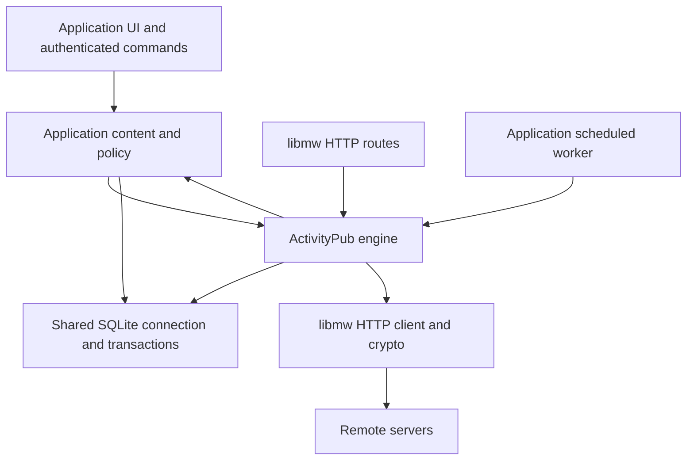

# Design Document: Reusable ActivityPub Library

**Status:** Proposed
**Date:** 2026-10-28
**Baseline:** Unspoken commit `edbef3c`
**Working library name:** `actpub`; namespace `ap`; CMake target
`ActPub::actpub`.
**Current consumer:** Unspoken.
**Future use cases:** A blog and a photo stream application.
**Infrastructure assumptions:** C++23, libmw HTTP server/client, libmw
cryptography and error handling, and SQLite through `mw::SQLite`.
**Related designs:** [Architecture](design-0-architecture.md),
[interop](design-2-interop.md), and
[remote actor lifecycle](design-4-actors.md).

## 1. Decision and scope

Extract ActivityPub server-to-server behavior into an embeddable C++ library.
Build it inside this repository and migrate Unspoken onto its public API.
The implementation stops after Unspoken is migrated and validated. A second
consumer, external packaging, and a separate repository are deferred.

The library owns federation identities, protocol validation, discovery,
follows, interactions, object representations, inbox deduplication, durable
outbound delivery, and federation maintenance. Applications own their users,
authentication, content editing, media bytes, presentation, and moderation
policy. Application content and federation state share one SQLite database.
Operations that change both use the same connection and transaction.

A blog can publish a long-form object and receive remote replies without
implementing HTTP signatures or delivery retries. A photo application can
publish a caption and ordered image attachments through the same library.
Unspoken continues to provide its current UI, local account model, and
microblog semantics through an application adapter.

This is an extraction with necessary boundary changes, not a rewrite of the
working federation implementation. Preserve existing transport behavior and
interop coverage while moving it. New transaction composition and worker
recovery behavior are specified explicitly because the current interfaces
cannot provide the required guarantees to another application.

### 1.1 Goals

- Reuse the existing signature, discovery, outbound-address protection, actor
  lifecycle, delivery, and ActivityPub processing code.
- Integrate directly with libmw and SQLite; require no alternate transport
  or database interfaces.
- Support application-supplied actor and object URIs, including existing
  Unspoken URIs without changing their identity.
- Support `Note`, `Article`, and image-bearing objects without forcing all
  consumers into Unspoken's `Post` structure.
- Make local content publication and delivery scheduling atomic.
- Make accepted inbox effects, host projections, and deduplication atomic.
- Preserve current actor keys, follows, interaction IDs, posts, queued
  deliveries, and URLs during migration.
- Offer a useful default implementation. Consumers implement application
  policy and projections rather than an entire federation database.

### 1.2 Non-goals

- ActivityPub client-to-server APIs, OAuth, OIDC, sessions, or user login.
- A generic database backend, ORM, HTTP framework adapter collection, or C ABI.
- A second consumer/example application, external package installation and
  exports, or a separate library repository in this implementation.
- A full JSON-LD processor or automatic fetching of remote contexts.
- HTML sanitization, presentation escaping, or a shared HTML allowlist.
- Media upload, image resizing, storage backends, or image content validation.
- Timelines, feeds, search UI, Markdown editing, or application pagination.
- Automatic account migration, portable accounts, groups, or arbitrary
  extension semantics in the first extraction.
- Exactly-once delivery across independent servers.
- Changing Unspoken's local timeline inclusion policy as part of extraction.
  Protocol-facing object access still requires explicit authorization.

## 2. Current implementation and extraction boundaries

These observations describe the baseline code, not the proposed API.

| Existing component | Reusable behavior | Required boundary change |
| --- | --- | --- |
| [`federation.cpp`](../src/federation.cpp) | Signing, verification, WebFinger, fetching, dispatch, forwarding, delivery | Split protocol code from `User`, `Post`, URL prefixes, rendering, and `DataSourceInterface` |
| [`federation.hpp`](../src/federation.hpp) | Request and signature types, federation entry points | Publish library types with explicit ownership and transaction contracts |
| [`data.cpp`](../src/data.cpp) | Actor, follow, interaction, receipt, and job SQL | Move federation tables; compose writes through a shared connection |
| [`data.hpp`](../src/data.hpp) | Typed data operations and tests | Keep the application data interface private to Unspoken |
| [`structs.hpp`](../src/structs.hpp) | Actor, activity, addressing, interaction concepts | Separate OIDC identities and application post IDs from protocol identities |
| [`app.cpp`](../src/app.cpp) | Inbox/outbox/discovery endpoints and worker loop | Delegate protocol endpoints and outbound commands to the library |
| [`service.cpp`](../src/service.cpp) | Local interactions and recipient construction | Coordinate content writes with library commands in one transaction |
| [`render.cpp`](../src/render.cpp) | Application HTML sanitization and Markdown rendering | Keep in Unspoken; the library exposes protocol content without presentation guarantees |
| [`tests/interop`](../tests/interop/README.md) | Akkoma and lifecycle-peer integration coverage | Run unchanged scenarios against the migrated application |

The current federation code recognizes local actors by `/u/` and local posts
by `/p/`. `noteJson()` always emits `Note`; embedded Create handling accepts
only `Note`. `User` includes OIDC subject information and private keys.
`DataSourceInterface` also exposes sessions, bookmarks, application profile
fields, and timelines. None of these application assumptions belongs in the
new public API.

The data implementation frequently starts `BEGIN IMMEDIATE` internally.
It owns its connection through a `unique_ptr`. Calling these operations
inside a host transaction would attempt nested top-level transactions.
Refactoring transaction ownership is therefore a prerequisite to extraction.

`runFederationJobOnce()` already separates one unit of work from the loop
that schedules it. Preserve that shape. Existing job claims mark rows as
running without a persisted expiry; the new queue adds recoverable leases.

## 3. References and terminology

The following references establish protocol and database behavior. Decisions
about API ownership, schemas, hooks, and application policy below are this
design's choices.

- [ActivityPub](https://www.w3.org/TR/activitypub/): federated delivery,
  inboxes, outboxes, and activity processing.
- [ActivityStreams core](https://www.w3.org/TR/activitystreams-core/) and
  [vocabulary](https://www.w3.org/TR/activitystreams-vocabulary/): JSON
  representations and object/activity types.
- [WebFinger, RFC 7033](https://www.rfc-editor.org/rfc/rfc7033.html): account
  discovery.
- [Legacy HTTP signature draft](https://datatracker.ietf.org/doc/html/draft-cavage-http-signatures-12):
  reference for the existing Signature-header implementation. It is an
  expired draft, not a current standard.
- [HTTP Message Signatures, RFC 9421](https://www.rfc-editor.org/rfc/rfc9421):
  a different signature format; supporting it is a separate future change.
- [SQLite transactions](https://www.sqlite.org/lang_transaction.html),
  [savepoints](https://www.sqlite.org/lang_savepoint.html), and
  [WAL](https://www.sqlite.org/wal.html): transaction composition and
  concurrent connections.
- [SQLite backup API](https://www.sqlite.org/backup.html): consistent backup
  before schema migration.
- [libxml2 HTML parser](https://gnome.pages.gitlab.gnome.org/libxml2/html/HTMLparser_8h.html):
  HTML parsing used by Unspoken's application sanitizer; not a library
  dependency.

An **actor URI** is a protocol identity, distinct from a username or host
user's integer ID. An **object URI** identifies a post, article, image, or
other content object. An **activity URI** identifies a particular operation;
creating, updating, liking, undoing, and recreating are different operations.

A **wire document** is validated ActivityStreams JSON intended for federation.
A **projection** is the application's own representation, such as a comment
row or an Unspoken remote post. An **audience** is the set of protocol
recipients. A **delivery** is one durable attempt stream to a destination
inbox. An **inbox receipt** records completed local processing, not merely
arrival of an HTTP request.

## 4. Architecture and ownership



The engine contains immutable validated configuration and references to
transport, crypto, clock, and application hooks. A session binds an engine
to one borrowed `mw::SQLite&`. Each request thread and worker uses its own
connection/session; references and prepared values must not escape their
specified lifetime. Database and network sessions are not shared between
workers merely because their underlying wrappers can serialize individual
calls. Transaction ownership spans multiple calls.

| State or behavior | Owner |
| --- | --- |
| OIDC identity, account permissions, session cookies | Application |
| Actor URI, keypair, actor document snapshot | Library |
| Mapping from a host user to one or more local actors | Application |
| Remote actor retention and refresh | Library |
| Blog entry, photo album, Unspoken source post | Application |
| ActivityStreams object snapshot and protocol ownership metadata | Library |
| Media bytes and absolute media URLs | Application |
| HTML sanitization, presentation escaping, and rendering policy | Application |
| Follow protocol and accepted/pending relationship state | Library |
| Like/Announce/EmojiReact protocol state | Library |
| Timeline and comment display queries | Application projections |
| Deduplication, outbox history, delivery jobs | Library |
| Follower approval, relevance, moderation | Application policy |
| Signature and object-ownership validation | Library; cannot be bypassed by policy |

Keeping a protocol snapshot does not make the library the application's
content database. The host retains its native model and writes a derived
ActivityStreams representation in the same transaction. That snapshot lets
workers and protocol GET endpoints operate without reconstructing a blog
entry after it has changed or been deleted.

## 5. Package layout and dependencies

Start with this layout inside the existing repository:

```text
lib/actpub/
    CMakeLists.txt
    include/actpub/
        actor.hpp
        application.hpp
        config.hpp
        engine.hpp
        error.hpp
        http.hpp
        object.hpp
        store.hpp
        transaction.hpp
    src/
        actor.cpp
        delivery.cpp
        discovery.cpp
        engine.cpp
        http.cpp
        inbox.cpp
        object.cpp
        signature.cpp
        store.cpp
        transaction.cpp
    tests/
src/                         # Unspoken and its adapter
```

Source filenames use snake_case; exported types use CapCase, functions use
camelCase, and enum values use UPPER_CASE. Every public declaration documents
its intention, ownership, transaction behavior, and possible errors.

The library uses the parent project's libmw, nlohmann/json, and spdlog
dependencies. Public requirements include libmw errors/SQLite and JSON.
HTTP/crypto implementations use libmw. libxml2, Markdown, Inja, cxxopts,
rapidyaml, OIDC, templates, and Unicode picker generation are not library
requirements. Unspoken keeps libxml2 for its own HTML sanitizer; another
consumer may use a different sanitizer or display content as plain text.

Expose `ActPub::actpub` as the primary target, linked by Unspoken through
`add_subdirectory()`. Declare transitive dependencies on the target so
Unspoken does not need private include paths into the library. Installation,
exported package configuration, and external consumer validation are deferred.
Do not start downloads, generate emoji data, or run schema migrations as a
side effect of merely configuring the library. Library tests are optional
when embedded.

Retain mockable libmw HTTP and crypto interfaces. Test clocks have a tiny
library `Clock` interface because time controls expiry and retry behavior.
There is no public generic storage interface: SQLite is the supported store.

## 6. Public data model

### 6.1 Local actors

A local actor registration contains:

- Stable `actor_uri`, inbox, outbox, followers, and following URIs.
- Discovery username and domain; these do not prescribe the URL path.
- Actor type, initially `Person`, `Service`, or `Application`.
- Display name, host-supplied summary HTML, icon/banner URLs, and profile
  fields. The host applies its own content policy before registration.
- Public document extension fields retained as JSON.
- Key ID and keypair, generated by the library or imported during migration.
- An enabled flag and creation/update timestamps.

The host maps its own IDs to `actor_uri`. The library accepts no OIDC subject
and assumes neither one actor per user nor a real user for the system actor.
Private keys are never included in actor documents or ordinary query models.
Key material is loaded only by signing operations. Filesystem/database access
controls remain the host operator's responsibility.

All local endpoints must be exact registered URIs on configured owned
origins. Recognition of local identity uses the registry, not URL-prefix
matching. Registration rejects duplicate actor URIs, ambiguous discovery
handles, and endpoint collisions.

### 6.2 Objects and activities

Use typed envelopes around extensible JSON. Do not create a C++ class
hierarchy for every ActivityStreams vocabulary entry.

An `ObjectDocument` contains a stable URI, owner actor URI, type, wire JSON,
audience, optional reply target, published/updated timestamps, and deletion
state. Typed fields must agree with their JSON counterparts; disagreement
is a validation error rather than an implicit overwrite.

The initial supported content types are `Note`, `Article`, and `Image`.
Attachment objects may be `Image` or `Document`. A host may publish an
unsupported extension object through an explicitly registered type handler;
by default unknown incoming object types are ignored. Retain unknown JSON
fields on supported documents without claiming to understand them.

An `Audience` carries `to` and `cc`. Normalize string/array/reference shapes
into URI lists, remove duplicates, and preserve the Public IRI. Keep the
actual recipient URIs rather than deriving them solely from a four-valued
visibility enum. Unspoken can retain its enum as a convenience mapping.
The first extraction rejects outbound `bto`/`bcc`; it must not accidentally
broadcast private hidden-recipient fields.

An `ActivityDocument` contains immutable activity URI, type, actor URI,
object JSON or reference, audience, and original validated JSON. Supporting
`Create`, `Update`, `Delete`, `Follow`, `Accept`, `Reject`, `Undo`, `Like`,
`Announce`, and the existing `EmojiReact` extension preserves the intended
consumer surface. Add missing Reject handling with tests; do not advertise
it until implemented.

### 6.3 Untrusted content and application presentation

The library preserves validated wire JSON without sanitizing its content.
Protocol validation establishes structure, signatures, ownership, addressing,
and resource limits. It does not establish that HTML, text, or media metadata
is safe to render. This distinction applies to actor profiles, object
content, summaries, attachments, and extension fields.

The application chooses how to interpret and display those fields. It may
sanitize HTML into its own stored projection, convert content to plain text,
or retain it without rendering. A blog and a photo stream can therefore
apply different presentation policies. The library has no `sanitizeHtml()`
API, HTML parser dependency, sanitized-content columns, or safe-HTML types.

Unspoken keeps its existing libxml2 sanitizer in the application and uses it
when building remote post/profile projections. Its sanitizer decodes HTML
entities through the parser and escapes once on serialization. Plain-text
fields such as attachment names stay text; the host escapes them for the
specific output context. Other applications are not required to use this
sanitizer or its allowlist.

Forwarding uses the authenticated wire document, independently of any host
projection. Never replace a wire document's content with sanitized HTML and
then claim the modified document is the original authenticated activity.
Library API documentation must explicitly state that authenticated content
remains untrusted for rendering; events must not label incoming fields safe.

The host supplies absolute media URLs, MIME types, names/alt text, dimensions
when available, sensitivity, and attachment order. No local filename or
content-hash layout is imposed. The library does not download remote media
or make an uploaded SVG safe to serve. The existing SVG warning remains
applicable to Unspoken's media endpoint.

### 6.4 Immutable identities and retry keys

A new activity receives a random 128-bit identifier generated through libmw.
The host supplies the base activity URI prefix at configuration. Persist the
result before delivery; retries reuse the stored activity and bytes.
Repeated enable operations on an existing interaction return its existing
activity URI. Undo references that exact activity. Re-enabling after Undo
creates a new URI. Never construct IDs solely from user/object IDs or
second-resolution timestamps.

A host may supply a unique `command_key` to make a retried local HTTP command
return the same publication result after an uncertain response. Scope the
key by local actor; store a normalized command fingerprint and reject reuse
for different content. The command key is distinct from an activity URI.

## 7. API shape and contracts

The following is an API outline, not a header ready for compilation. Names
are proposed public names. Supporting value types are described in this
section and the storage sections. Implement the contracts before freezing
binary or source compatibility.

```cpp
namespace ap
{

// Own one explicit write transaction on a borrowed connection.
class Transaction
{
public:
    // Begin IMMEDIATE; fail if this connection has an active transaction.
    static mw::E<Transaction> begin(mw::SQLite& db);

    // Expose the same connection for transactional host writes.
    mw::SQLite& connection();

    // Commit all host and library writes together.
    mw::E<void> commit();

    // Roll back if commit has not succeeded; move-only, never throws.
    ~Transaction();
};

// Decide application policy and project accepted protocol effects.
class Application
{
public:
    virtual ~Application() = default;

    // Decide relevance/moderation using only this transaction's database.
    virtual mw::E<Decision> decide(
        Transaction& tx, const ValidatedActivity& activity,
        const LocalRecipient& recipient) = 0;

    // Update host projections after accepted library protocol mutations.
    virtual mw::E<void> apply(
        Transaction& tx, const AppliedEvent& event) = 0;

    // Supply application-specific NodeInfo counts and metadata.
    virtual mw::E<SiteInfo> siteInfo(mw::SQLite& db) const = 0;
};

// Bind federation operations to one caller-owned SQLite connection.
class Session
{
public:
    // Publish local content and durable delivery targets, without I/O.
    mw::E<Publication> publish(
        Transaction& tx, const PublishCommand& command);

    // Follow/unfollow, accept/reject, like/boost/react and Undo atomically.
    mw::E<CommandResult> execute(
        Transaction& tx, const InteractionCommand& command);

    // Register an actor or update its public profile and enqueue Update.
    mw::E<ActorView> registerActor(
        Transaction& tx, const ActorRegistration& registration);
    mw::E<Publication> updateActor(
        Transaction& tx, const ActorUpdate& update);

    // Fetch and verify without holding a write transaction.
    mw::E<PreparedInbox> prepareInbox(const InboxRequest& request);

    // Apply prepared effects and receipts in one short owned transaction.
    mw::E<InboxResult> acceptInbox(PreparedInbox&& prepared);

    // Perform at most one leased background job, including network I/O.
    mw::E<WorkResult> runOnce();

    // Prune bounded expired state without starting a worker thread.
    mw::E<MaintenanceResult> maintain();
};

} // namespace ap
```

`Engine::openSession(mw::SQLite&)` constructs a borrowing session after
checking schema compatibility and connection configuration. `Engine` also
provides explicitly named read queries for actors, objects, followers,
interactions, and outbox pages. A `Session` accepts only transactions bound
to its connection. It does not assume that two connections to the same file
share a transaction.

`PublishCommand` includes operation (`CREATE`, `UPDATE`, `DELETE`), local
actor URI, object document or delete target, audience, and optional command
key. `Publication` returns activity URI, object URI, outbox sequence, and
number of durable targets. A successful return before `commit()` is
provisional; the caller must not announce success if commit fails.

`InteractionCommand` is a discriminated typed value for follow, approval,
like, boost, emoji reaction, and Undo. Include an explicit local actor,
target URI, desired state, and optional command key. A stringly typed JSON
command endpoint is unnecessary. Local application authorization occurs
before calling these methods: the library proves actor locality but does
not know which logged-in user may act for it.

`Decision` is `ACCEPT`, `IGNORE`, `REJECT`, or `PENDING_APPROVAL`. Only a
Follow may return `PENDING_APPROVAL`; it stores the pending relation without
issuing Accept. `REJECT` for Follow emits a Reject activity; for other
content it means a completed policy rejection without an outgoing protocol
response. `IGNORE` records the receipt and retains no unnecessary actor.

`AppliedEvent` is a value object with activity ID, recipient actor URI,
effect kind, affected object/interaction identity, and protocol field values
or wire JSON where needed. Content remains untrusted for rendering; no field
carries a library-provided HTML safety guarantee. The application sanitizes
or otherwise transforms content when creating its presentation projection.
Hooks run synchronously under the transaction and may perform bounded,
deterministic in-memory transformations, including application sanitization,
and SQLite work on that transaction's connection. They must not fetch remote
URLs, send email,
write media files, or invoke engine methods that acquire another top-level
transaction. Durable external notifications can be inserted into a host
notification queue in the same transaction.

`ValidatedActivity` and `PreparedInbox` have private constructors. Only the
library can produce them through validation. A host cannot mark arbitrary
JSON as authenticated by constructing a public struct. Application policy
cannot override failed signatures or object ownership checks.

`WorkResult` distinguishes `IDLE`, `COMPLETED`, `RESCHEDULED`, and
`PERMANENT_FAILURE`, with job ID and sanitized diagnostic category.
`mw::E<>` carries local operational failures. Do not throw for peer-supplied
JSON type errors; check types and return a protocol error or ignored result.

## 8. SQLite ownership and transaction rules

### 8.1 Database and connection lifecycle

Use the same physical SQLite database for host and federation tables. Use a
fixed `ap_` table/index prefix. A dynamic prefix would complicate SQL and
migration verification without helping the intended consumers. One database
contains one application installation with many actors. Independently
deployed applications normally use separate database files.

The application owns connections and passes `mw::SQLite&`. Refactor
Unspoken's data class to support a borrowed connection while preserving an
owning convenience factory if useful. Application repositories and the
library session for a request must use that exact connection.

Startup enables foreign keys, busy timeout, and the chosen WAL/durability
settings before accepting traffic. The library verifies required settings
but does not change journal mode inside a transaction. Schema migration is
an explicit startup operation before workers start. Tests may use in-memory
SQLite; multi-connection tests use temporary files rather than separate
`:memory:` databases.

### 8.2 Transaction ownership

`Transaction::begin()` is the top-level write boundary. An internal rollback
guard rolls back on every error path and on destruction. Retrying occurs at
the operation boundary after rollback, never by replaying an arbitrary
mid-transaction fragment. If COMMIT reports ordinary contention while the
transaction is still valid, retry COMMIT within a bounded budget; for other
failures roll back, report failure, and discard a connection whose rollback
cannot be confirmed.

Lower-level store methods execute SQL using the supplied transaction. They
never issue `BEGIN`, `COMMIT`, or an unrelated `ROLLBACK`. A library command
may use a uniquely named savepoint to leave the caller's transaction clean
when that command fails. Releasing that savepoint does not commit the outer
transaction. See SQLite's [savepoint semantics](https://www.sqlite.org/lang_savepoint.html).

libmw currently exposes SQL execution and changed-row counts but no
transaction ownership abstraction. Implement the guard in this library
first using its supported SQLite API. Check active state using a supported
libmw helper, or obtain the connection through
[`sqlite3_db_handle()`](https://www.sqlite.org/c3ref/db_handle.html) on a
temporary statement and inspect
[`sqlite3_get_autocommit()`](https://www.sqlite.org/c3ref/get_autocommit.html).
Do not add a raw connection accessor as a prerequisite. If a
small libmw transaction helper is later useful elsewhere, move it in a
separate change after its behavior is tested here.

Do not copy current data methods' per-method `withWriteRetry()` wrappers into
an enclosing transaction. Audit libmw's statement-level contention retry
behavior as part of the transaction tests. Statements must not discard or
commit a transaction behind the transaction owner's back.

### 8.3 Two important boundaries

**Local publication:** host content write + protocol snapshot + activity +
delivery targets + command key commit together.

**Incoming activity:** library effects + host projections + all per-recipient
receipts + queued replies/forwarding commit together.

Neither boundary includes an HTTP request to a peer. SQLite permits only one
writer at a time; holding a write transaction during DNS, actor fetches, or
HTTP delivery would serialize unrelated application writes.

## 9. Persistent schema

All tables below use explicit migrations owned by the library. Schema v1 is
the extracted library's first version; it is independent of Unspoken's
current application schema v3. Required JSON and timestamp fields are
validated before SQL insertion. Use foreign keys, uniqueness constraints,
and checked state values, not only C++ preconditions.

### 9.1 Identity and object tables

| Table | Primary/unique identity | Important columns and rules |
| --- | --- | --- |
| `ap_schema` | singleton `id = 1` | version, migration time; unknown newer version blocks startup |
| `ap_local_actors` | actor URI; unique handle and endpoint URIs | profile JSON, endpoint URIs, key ID/PEMs, enabled, timestamps |
| `ap_remote_actors` | integer ID; unique actor URI | raw actor JSON, inbox/shared inbox, key metadata, fetched/retained timestamps |
| `ap_objects` | object URI; unique sequence | owner URI, local/remote flag, type, wire JSON, audience JSON, reply URI, published/updated, tombstone |
| `ap_actor_refs` | `(actor_uri, owner_kind, owner_key)` | explicit remote identity pins for retained objects and host-only projections |
| `ap_follows` | integer sequence; unique follower/followee pair | state, original Follow activity URI, current approval activity URI, timestamps |
| `ap_interactions` | integer sequence; unique actor/object/kind/value | Like/Announce/EmojiReact identity, original activity URI, emoji metadata |

Use opaque URIs for relationships to host objects; there are no foreign keys
from library tables into application tables. A host that retains a remote
identity outside the library calls `pinActor()`/`unpinActor()` within its
transaction. Pins use a stable owner kind/key so retries are idempotent.

`ap_objects` stores only accepted, relevant remote objects and registered
local objects. It is not a cache of every object mentioned in traffic.
Deleting content replaces the current snapshot with a tombstone while
preserving its URI and owner. Outgoing activities retain the historical
snapshot they were created with.

Index remote actor retention time; object owner and sequence; reply URI;
followee/state/sequence; follower/state/sequence; and interaction object/kind.
Unspoken's integer remote actor IDs can initially be preserved when copying
actors, easing the application projection migration.

### 9.2 Activity and receipt tables

| Table | Identity | Purpose |
| --- | --- | --- |
| `ap_outbox` | sequence; unique activity URI | Immutable serialized activity, actor, object URI, audience, created time |
| `ap_commands` | `(local_actor_uri, command_key)` | Command fingerprint and resulting activity URI |
| `ap_inbox_activities` | activity URI | Authenticated actor, identity fingerprint, global-effect marker/result, processed time |
| `ap_inbox_receipts` | `(activity_uri, local_recipient_uri)` | Applied/ignored/rejected result for each local recipient |
| `ap_legacy_receipts` | activity URI | Temporary compatibility records for migrated completed IDs without actor/scope metadata |

Activity-level deduplication alone is insufficient when one shared-inbox
request affects several local actors or an activity later reaches another
personal inbox. Store one authenticated identity and separate receipts for
local recipient effects. A retransmission may add a previously unprocessed
local recipient, but must not repeat an already completed effect.

The fingerprint includes immutable activity identity fields and canonical
normalized payload, excluding only explicitly documented transport/context
normalizations. Reject a different actor or materially different activity
using an already recorded ID. Do not trust peer-controlled IDs merely
because they match a local uniqueness constraint.

Global object/follow/interaction changes use their own unique keys and an
activity-level global-effect marker. When a later delivery adds a recipient,
do not replay an already applied Update or Delete against the current object
snapshot. Preserve the first applied result for recipient projections. An
activity initially ignored for every recipient may apply its global effect
once if a subsequent legitimate recipient accepts it. Check and update this
marker inside the same transaction as the effect. Host recipient projections use `(activity_uri, recipient_uri, effect_kind)` as an
idempotency key. This prevents shared object storage from duplicating
per-user notification/comment subscriptions.

### 9.3 Delivery tables

`ap_deliveries` contains:

- Integer job ID; activity URI referencing `ap_outbox`.
- Signer actor URI; target actor URI and selected inbox, when resolved.
- Job kind (`RESOLVE_TARGET`, `DELIVER`, or `FETCH_OBJECT`).
- State (`PENDING`, `RUNNING`, `DONE`, `FAILED`, `CANCELLED`).
- Attempt count, next-run time, bounded last-error category/message.
- Random lease token, lease expiry, creation/completion timestamps.
- Payload version and bounded payload for fetch jobs.

Enforce uniqueness for one activity/target actor at target snapshot time,
and for one activity/inbox/signer after safe inbox grouping. Use partial
indexes for runnable jobs and expired running leases. Store target actor
rows or references so retention cannot delete identities needed by pending
jobs. Store private activity bodies once in `ap_outbox`, not in logs.

Delivery ordering is best-effort per signer/destination: an earlier pending
or running activity blocks a later one for that stream. A permanent failure
unblocks it but remains visible to the operator. Do not reorder Create,
Update, and Delete merely because different workers claimed them. Unknown
inboxes are resolved before selecting the stream; preserve outbox sequence
when merging targets into an inbox stream.

## 10. Local publication and interactions

### 10.1 Publishing content

A typical blog publication proceeds as follows:

1. Authenticate the local user and authorize use of the selected local actor.
2. Prepare rendered HTML/media URLs and immutable content values without a
   write transaction. Upload completion precedes publication.
3. Open `Transaction` on the request connection.
4. Insert/update the application's blog row and determine its stable URI.
5. Build `PublishCommand` with its ActivityStreams document and audience.
6. The library verifies actor registration, object ownership, type handler,
   audience consistency, extension-field bounds, and command-key reuse.
7. Store the current object snapshot and an immutable activity in outbox.
8. Snapshot accepted recipient actor URIs into delivery-target rows. Expand
   local follower collections in SQLite now, so future followers do not
   receive an old private publication. No network access occurs here.
9. Apply any local-recipient effects through the same validated dispatch
   path without an HTTP round trip or network signature requirement.
10. Commit all application and library writes. Respond only after commit.
11. Workers resolve unknown inboxes and deliver the stored activity later.

Fan-out writes are bounded by an explicit configured target limit. If the
transaction would exceed that supported instance size, fail atomically with
an actionable error; do not silently drop recipients. A future batched
fan-out implementation must persist a membership snapshot before returning
success rather than reading a changing follower list later.

Missing remote keys/inboxes do not make saving a public blog post depend on
network availability. Follow/mention discovery may be explicitly performed
before publication; unresolved registered targets become resolution jobs.
Unknown arbitrary actor URIs are validated before they become fetch targets.

A local Update retains object URI and creates a fresh activity URI. Delete
records a tombstone and snapshots the necessary recipients before dropping
application content. Application edits that change audience must retain
sufficient prior delivery information for correct update/delete handling;
the library must not infer all former recipients from today's followers.
For the first release, changing an existing nonpublic object's audience is
rejected unless its type handler implements and tests that transition.

### 10.2 Follow and interaction commands

Follow inserts a pending relation and queues the Follow atomically. Incoming
Accept/Reject must match the actual pending Follow and correct actor pair.
Repeated Follow does not silently create a new operation while one exists.
Unfollow queues Undo referring to the saved Follow before removing or
transitioning the relation.

Like, Announce, and EmojiReact store protocol state and outgoing activity
atomically. Repeated enable returns the persisted activity. Disable emits
Undo only if the interaction exists. A later enable gets a fresh activity
ID. Undo must match the referenced operation, not merely the actor/object
pair: a delayed Undo for an older Like must not erase a newer Like.

Only publicly redistributable objects may be announced by the default
handler. EmojiReact remains an optional extension, with explicit size and
media URL checks. Host bookmarks and local-only reactions stay outside the
library unless the host deliberately maps them to federation operations.

### 10.3 Example application mapping

| Consumer | Native content | Example protocol projection |
| --- | --- | --- |
| Unspoken | Markdown source post and attachment relations | `Note` with HTML, mentions, hashtags, and attachments |
| Blog | Entry title, body, slug, publication state | `Article` with `name`, `content`, and canonical URL |
| Photo stream | Caption and ordered media records | `Note` with image attachments, or explicit `Image` object |

Object types are application choices. The library preserves their fields
and tests serialization; it does not promise every remote UI presents every
type identically. Library tests exercise Article and image-bearing objects
to expose accidental Note-only assumptions. Building blog and photo stream
applications is outside the current implementation scope.

## 11. Inbox processing and application hooks

### 11.1 Prepare outside the write transaction

1. Enforce configured body/header limits and preserve method, original
   request target including query, relevant headers, and exact body bytes.
2. Verify date/digest/signature-envelope requirements before unnecessary
   actor fetches. Use the same verification rules as the existing code.
3. Fetch an unknown actor transiently or refresh a retained actor's key.
   A refreshed key is accepted only when it proves this request.
4. Parse and normalize the activity, its IDs, actor, addressing, object,
   and supported JSON shapes with bounded depth and sizes.
5. Establish actor/object authority. A signature authenticates a signer;
   it does not grant authority over arbitrary objects named in the body.
6. Resolve referenced objects and bounded forwarding evidence using signed,
   outbound-protected GETs when the existing feature requires it.
7. Build a private `PreparedInbox` value containing evidence, normalized
   documents, intended endpoint scope, and an expiry deadline.

No unverified signer becomes a durable remote actor as a side effect of
preparation. A read-only duplicate lookup may skip additional fetch work
only after authentication. Prepared values are short lived, bound to the
engine configuration, and cannot be reused after consumption.

### 11.2 Commit accepted effects together

1. `acceptInbox()` starts a short `BEGIN IMMEDIATE` on its session connection.
2. Revalidate prepared expiry and current local actors, object ownership,
   follows, and recipient relevance against database state.
3. Resolve effective local recipients. A personal inbox constrains the
   target actor; shared inbox recipients come from addressing, supported
   collection membership, and validated interaction targets. Possession of
   a personal inbox URL alone never grants access to private content.
4. Check activity identity and migrated legacy receipts. For each recipient,
   skip an existing completed receipt.
5. Call `Application::decide()` for each new eligible recipient.
6. Apply allowed protocol effects only if their activity-level marker is
   unset; record the applied result with that marker. Retain actors only
   when accepted state, jobs, or host pins need them. For each new recipient,
   call `Application::apply()` with the original applied result using the
   same transaction, without replaying the global mutation.
7. Queue required Accept/Reject/Undo/forwarding work in that transaction.
8. Record all applied, ignored, or rejected recipient receipts and the
   authenticated activity identity.
9. Commit. Only now return a successful inbox HTTP response.

There is no separate persisted processing claim in the new inbox path.
Preparation does no application mutation; the short writer transaction
serializes receipt checks with effects. A crash before commit leaves no
partial effect or stale claim, and redelivery can retry immediately. A
crash after commit produces a duplicate. This deliberately replaces the
current claim/effect/finalize sequence rather than carrying its separate
lease into a design that no longer needs it.

Concurrent duplicate requests may duplicate verification/fetch work, but
cannot commit the same recipient effect twice. Optimize that cost later
with a bounded transient cache if measurements justify it.

### 11.3 Authority, forwarding, and unsupported traffic

For direct Create/Update, validate the authenticated actor against the
object's author and any existing stored owner. For Delete, authority must
match the stored owner; a Tombstone's type alone is insufficient. For
Accept/Reject, validate the exact Follow relation and actor pair. For Undo,
validate the original activity identity and actor.

Preserve the existing distinct forwarded-delivery path and its interop
coverage. A forwarder signature is not proof of the original actor's
permission. Retrieve and verify authoritative origin data as required by
the existing forwarding algorithm before applying or forwarding effects.
Enforce depth, cycle, response-size, and request-count budgets. Unsupported
or unprovable forwarding is ignored; never fall back to trusting the
embedded claimed actor. Forwarding jobs retain the authenticated original
JSON rather than a sanitized or host-reconstructed substitute.

Unsupported activity/object types produce a completed ignored outcome with
no unnecessary permanent actor retention. Unknown application extension
handlers cannot bypass signature, ownership, or audience checks. A handler
must declare supported object types and mutation semantics; raw JSON
preservation is not automatic permission to execute unknown activity types.

## 12. HTTP integration

The library exposes handler methods using `mw::HTTPServer::Request` and
`Response`. The host registers routes from its derived server's `setup()`
method and delegates to the handlers. `mw::HTTPServer` currently keeps its
underlying server protected, so the design must not assume a public
`registerRoutes(mw::HTTPServer&)` function can reach it without a libmw change.
A convenience registration helper may accept the existing `httplib::Server&`
from inside that setup method; direct handlers remain the stable API.

| Endpoint role | Host-provided URI/routing | Library responsibility |
| --- | --- | --- |
| Actor GET | Exact registered actor URI | Public actor document and representation headers |
| Object GET | Existing content route or dedicated protocol route | Snapshot/tombstone and audience authorization |
| Inbox POST | Registered personal/shared inbox | Preparation, commit, HTTP result |
| Outbox GET | Registered actor collection | Public protocol activity pagination |
| Followers/following GET | Registered collection URIs | Collection documents, approved relationship pages |
| WebFinger | `/.well-known/webfinger` on discovery host | Handle lookup and JRD response |
| Host-meta | `/.well-known/host-meta` | Discovery document |
| NodeInfo | Discovery plus configured schema route | Application metadata via hook |

There is no required `/u/` or `/p/` pattern. An application may reuse its
content URL through Accept negotiation or provide a dedicated protocol URI
with a separate browser-facing `url`. Preserve that distinction in objects.

Public/unlisted objects may be fetched anonymously. Nonpublic objects
require an authenticated actor that belongs to the stored audience under
the implemented authorization rules. Followers-only access checks an
accepted follow, not a pending one. A host may pass a separately authenticated
local actor through an explicit trusted API; cookies are not parsed by the
library. Unauthorized object GET returns 404. Outbox listings are public
only and must not leak private snapshots; a private delivery does not make
its activity publicly enumerable.

Set the appropriate ActivityPub/JRD content types and `Vary: Accept` on
negotiated routes. Private responses prohibit shared caching. Handle HEAD
consistently with GET authorization. GET rendering never starts a worker or
performs unbounded remote thread discovery.

Default inbox mapping: newly committed work returns 202; duplicate or
intentionally ignored work returns 200; malformed JSON/unsupported envelope
shape returns 400; invalid authentication returns 401/403 according to the
existing signature error classification; exceeded request limits return
413; transient storage/network dependency failures return 503 where retry
is appropriate. Do not return 202 before synchronous inbox effects commit.
Application policy decisions return successful processed outcomes, avoiding
endless peer retries for deliberately ignored content.

A missing database, migration mismatch, or internal failure must not expose
SQL, PEM data, or private document bodies in HTTP error responses.

## 13. Delivery workers, recovery, and maintenance

### 13.1 Claim, send, finalize

`runOnce()` performs one runnable job without owning a background thread:

1. In a short write transaction, select a pending runnable job or reclaim
   an expired running job, respecting per-stream order.
2. Generate a fresh random lease token, increment the attempt count, set
   lease expiry, and commit the claim.
3. Load immutable activity bytes and signer metadata. Resolve a destination
   if necessary through protected network operations outside the write lock.
4. Sign the exact bytes to be sent, with fresh Date/Digest headers as
   required by the current implementation, and issue the request.
5. In another short transaction, update the result only if job ID and lease
   token still match. A stale worker cannot complete a newer worker's claim.

Bound connect/read/total HTTP deadlines. Lease duration must exceed the
maximum bounded operation time plus finalization margin; validate this
configuration at startup. A multi-request fetch job must renew its token
between requests or stop before expiry. Do not use a transport setting that
can block indefinitely while a supposedly finite lease runs out.

A process may crash after the remote peer accepts a request but before
local finalization. The job will be resent with the same activity URI and
body. This is at-least-once transport; peers are expected to deduplicate.
Local transactions do not create an exactly-once network guarantee.

### 13.2 Destination grouping and retries

Snapshot target actor URIs at enqueue time. Resolution may refresh their
current inbox later. Group public/unlisted deliveries by shared inbox only
when signer and serialized audience/body are identical. Deliver private
content through personal inboxes initially; a later optimization needs
explicit tests preventing recipient-set mixing.

Retry transport failures, 408, 429, and 5xx with capped exponential backoff
and jitter. Honor a valid bounded Retry-After for retryable responses. Most
other 4xx responses become permanent failures, with a bounded refresh/retry
policy for stale destination metadata where supported. Do not follow a
redirect with an old signature or leak an authenticated body to an unchecked
host. Preserve the current hardened no-redirect policy initially.

Manual retry reuses the same stored activity identity; it does not invent a
new semantic operation. `FAILED` rows retain enough diagnostics for operator
inspection. Cancelling a job is explicit and must be observable.

### 13.3 Worker scheduling and shutdown

The host chooses worker count and creates one connection, session, crypto
context, and HTTP session per worker. It calls `runOnce()` repeatedly, sleeps
on IDLE, and checks a stop token between jobs. The library neither creates
threads in constructors nor sleeps inside an idle work call. Shutdown stops
new claims, waits for bounded active requests, and leaves unfinished claims
recoverable by expiry.

Maintenance prunes completed receipts and jobs in bounded batches. Do not
prune live leases, pending deliveries, failed work awaiting operator action,
or outbox snapshots still referenced by jobs. Retain current object
snapshots independently of historical outbox retention. Deleting old
receipts reduces transport deduplication history; stable object ownership,
interaction uniqueness, and command keys remain separate protections.

Remote actor collection checks objects, follows, interactions, pending
jobs, and explicit host pins before deletion, then applies the existing
grace period. Irrelevant signed unknown Delete traffic must not grow the
remote actor table permanently. Treat collection checks and deletion as one
transaction to avoid racing with new references.

## 14. Configuration, errors, and observability

Use `FederationConfig`, independent of YAML loading and Unspoken's Config.
The host parses its configuration and constructs this value. Include owned
origins, discovery domains, activity URI prefix, system actor registration,
signature skew, request/response size limits, fetch budgets, HTTP deadlines,
job leases/retry policy, receipt retention, actor collection grace period,
maintenance batch size, and the current test-only outbound allowlist.

Preserve baseline tuning defaults where behavior is unchanged. New limits
must have documented finite defaults and tests at their boundaries before
release. In particular, define an initial 1 MiB inbox body limit, 2 MiB
fetched JSON limit, 64-level JSON depth, 100 explicit address URIs, and
10,000 expanded local follower targets per command. Make these configurable
without changing the schema. These are initial operating limits, not
ActivityPub standards. Preserve the current bounded thread-fetch depth.

Configuration errors fail before routes/workers start. Remote protocols
return typed failure categories such as `INVALID_SIGNATURE`,
`INVALID_DOCUMENT`, `UNAUTHORIZED_OBJECT`, `FETCH_FAILED`, `LIMIT_EXCEEDED`,
`STORAGE_BUSY`, and `SCHEMA_MISMATCH`, carried through `mw::E<>`. Keep protocol
outcomes (duplicate, ignored, applied) separate from operational errors.

Use spdlog structured fields for operation, activity URI, job ID, recipient
scope, disposition, attempt number, lease recovery, and elapsed time. Never
log private keys, session cookies, Signature bytes, or full private bodies
by default. Keep verbose body logging an explicit host/operator choice.
Export lightweight counters/query results for runnable/failed jobs, oldest
pending job age, receipt outcomes, fetch failures, actor collection, and
migration version. No metrics backend is required.

## 15. Unspoken migration

### 15.1 Connection and code changes

Refactor the connection ownership first. Unspoken's thread-local request
connection and each worker connection remain, but both its application data
source and `ap::Session` borrow that connection. Replace application data
methods' independent top-level transaction/retry behavior where they now
participate in a library operation.

Implement `UnspokenApplication` hooks for relevance, current follow approval
behavior, remote post projections, interaction notifications, and site
counts. Keep HTML sanitization, Markdown rendering, local emoji lookup,
attachment URL construction, session handling, and HTML view models in the
application. Incoming projection hooks invoke Unspoken's existing libxml2
sanitizer before storing HTML for display. Profile views apply the same
application policy to raw remote actor fields. Local publish handlers
explicitly build ActivityStreams documents with application-produced content.

Unspoken may retain projection tables for efficient timelines, but protocol
writes go through the library. Do not maintain two independent authoritative
follow or interaction stores. Replace direct application SQL reads with
library queries where feasible; any retained projections must be updated
transactionally by hooks and rebuildable from library state.

### 15.2 Schema bridge from application v3

Implement an explicit Unspoken application migration v3 to v4, which invokes
the library's fresh-schema migration and copies existing federation state.
Older fixtures run existing v1-to-v2-to-v3 migrations before this bridge.
Take a consistent backup before startup migration. Stop old workers and
HTTP writes; mixed old/new writers are unsupported.

| Existing state | Migration action |
| --- | --- |
| `users` keys and system actor | Import keypairs and exact key IDs into registered local actors; map users by actor URI |
| `remote_actors` | Copy documents/metadata, preserving integer IDs initially; repair projection references before removal |
| Local/remote `posts` and recipients | Create protocol object snapshots with original URIs, owners, addressing, and timestamps; retain application content/projections |
| Attachments/profile media | Keep bytes/application relations; serialize current public URLs into snapshots |
| `follows` | Copy states and original Follow IDs; preserve sequence where application cursors depend on it |
| `likes`, `boosts`, `reactions` | Copy into typed interaction rows, retaining activity IDs and emoji metadata |
| Completed `seen_activities` | Copy to temporary legacy receipts with original processed times |
| Processing `seen_activities` | Discard claims after all old writers stop; committed partial effects rely on migrated unique identities on redelivery |
| Delivery `jobs` | Import immutable activity and signer, preserve body semantics, target and retry state; requeue running jobs with no old worker alive |
| Fetch-thread `jobs` | Convert to versioned fetch jobs; reject unknown payload versions visibly |
| Sessions, OIDC, bookmarks, picker data | Leave entirely in application schema |

For a legacy receipt lacking actor/recipient metadata, preserve its existing
global suppression behavior until its normal retention expires. New
receipts use scoped authenticated records. Do not fabricate signer evidence
for old rows or silently treat unknown actors as verified.

Migration-generated snapshots must not emit new Create activities for old
content. Existing outbox activity IDs must remain stable when reconstructing
historical entries: use the exact old IDs, including `/activity` where that
was the existing representation. For delivery jobs, preserve stored
activity IDs/body fields even if a historical outbox representation used a
different ID. Mark imported records explicitly rather than forcing them
through new command-key validation.

Legacy interactions can have absent activity IDs. Preserve null and the
baseline compatible Undo representation for those rows; assign new random
IDs only to new operations. Never rewrite an ID already used by a peer.

Current partial inbox effects may predate finalization, so migration cannot
retroactively guarantee atomic past processing. Preserve existing unique
object/relation keys; make hook imports idempotent and test redelivery after
migration. New processing uses the atomic contract from section 11.

### 15.3 Verification and removal

Within migration, compare actor/follow/interaction counts, distinct URIs,
keys, audience memberships, and pending job identities. Check foreign keys
and that every retained projection author resolves. Record the application
schema marker only after the complete copy/check transaction commits.
Perform expensive cryptographic key consistency checks before the write
transaction if possible, then verify imported values have not changed.

Remove application access to old federation tables before dropping them.
Retain application `posts` as projections/source storage, not as an alternate
protocol authority. Once the migration and fixture suite prove correctness,
drop obsolete follow/interaction/actor/job/receipt tables in the same release
migration, or retain them under explicitly read-only legacy names for one
release if required for inspection. Choose one tested path in implementation;
the default plan is drop after verified copy with a pre-upgrade backup.

Rollback after new traffic is received means restoring a consistent
pre-upgrade backup and accepting the loss of subsequent local changes, or
shipping a forward repair. Starting the old binary against the migrated
database is not a supported downgrade. Existing web content and actor URLs
must continue resolving before and after migration.

## 16. Implementation sequence

Each phase leaves a buildable Unspoken and has a specific completion check.
Do not migrate the production database while the engine boundary is still
changing daily.

### 16.1 Milestone 1: Library foundation

1. **Create the target and move protocol primitives.** Extract URI/address
   normalization, wire types, signatures, discovery, and protected fetching.
   Keep wrappers in existing namespaces temporarily. Run existing signature,
   fetch, discovery, and outbound-address tests unchanged.
2. **Introduce shared connection transactions.** Implement Transaction,
   savepoint composition, and rollback/retry tests. Refactor application data
   source borrowing. Prove host + library writes roll back together.

### 16.2 Milestone 2: Persistence and outbound federation

1. **Implement the prefixed store on fresh databases.** Add actor registry,
   object snapshots, outbox, scoped receipts, interactions, and leased jobs.
   Use real SQLite tests rather than implementing a second mock database API.
2. **Move outbound operations.** Route create/update/delete/follow/interaction
   scheduling through transactional commands. Preserve semantic activity IDs
   and test restart after commit before first send.

### 16.3 Milestone 3: Inbox and Unspoken migration

1. **Move inbox and protocol HTTP handlers.** Split preparation from commit,
   install host policy/projection hooks, and migrate object/collection GETs.
   Test all current forwarding and actor-lifecycle cases.
2. **Add the schema bridge and migrate Unspoken.** Validate v1/v3 fixtures,
   legacy IDs, queued/running jobs, author references, and unchanged endpoints.
   Remove old authoritative writes rather than dual-writing indefinitely.
3. **Validate the migrated application.** Run the complete unit and federation
   interop suites, exercise crash/recovery cases, and document operational
   startup and upgrade requirements.

Stop after milestone 3. A blog example, external CMake package exports, and
repository extraction are future work and are not completion requirements.

Compile with `-j24`. Run the relevant library and application tests at each
phase; run the complete unit and interop suites before the migration release.

## 17. Testing and acceptance criteria

### 17.1 Preserve existing behavior

Move relevant federation tests into the library while retaining application
view/service tests. Existing signer refresh, signed fetching, nonpublic
object authorization, interaction, forwarding, actor lifecycle, and Akkoma
scenarios must still pass. The baseline suite has 206 discovered tests;
record counts per target after splitting rather than requiring the numeric
count to remain identical when cases are reorganized.

### 17.2 Transaction and crash matrix

| Failure point | Required result after restart/redelivery |
| --- | --- |
| Host content saved, publish enqueue fails before commit | Neither host content nor publication visible |
| Publication commits, process exits before worker runs | Pending delivery survives |
| Host projection hook fails during inbox commit | No protocol effect, projection, or receipt committed |
| Duplicate inbox requests arrive concurrently | One effect per recipient; no split host/library state |
| Same activity reaches a second personal inbox later | New legitimate recipient applied; prior recipient skipped |
| Peer accepts delivery, worker dies before finalization | Same activity retried, never a new semantic ID |
| Running job lease expires | Another worker can claim it |
| Old worker completes after lease takeover | Token mismatch prevents stale finalization |
| SQLite busy before write boundary | Bounded retry with no partial command |
| COMMIT or rollback fails | Error surfaced; unusable connection discarded |
| Missing/unavailable remote inbox | Local publication remains durable; retry policy applies |

Use file-backed SQLite with two connections to exercise real contention.
Place deterministic failure hooks at transaction boundaries and worker
phases. Test clocks and libmw fake HTTP/crypto implementations make crashes,
timeouts, lease expiry, and delayed key refresh reproducible.

### 17.3 Protocol and policy coverage

Test exact actor registry matching, arbitrary URI layouts, object ownership,
repeated interaction enable/Undo/re-enable, delayed old Undo, Follow
Accept/Reject identity, pending follower access, private object GET/HEAD,
private outbox exclusion, original wire preservation, unsupported types,
field limits, malformed JSON types, and signed forwarding with
cycles/untrusted claimed authors.

Library tests must prove that HTML content, entities, and extension fields
survive protocol storage and forwarding without presentation rewriting.
Unspoken application tests retain the HTML sanitizer regressions, including
encoded unsafe HTML URLs, entity escaping, malformed markup, and profile
content. Verify the library target has no libxml2 dependency; raw content
round-trip tests establish that presentation policy stays in the application
without building another consumer.

Test identical and different bodies reusing an activity ID, two actors
claiming one ID, scoped receipts, explicit host pins, recipient snapshots,
and actor collection while a delivery is pending. Preserve the unknown
signed Delete traffic test so extraction cannot reintroduce actor growth.

### 17.4 Migration and integration coverage

- Upgrade sanitized v1 fixture through existing migrations and the bridge.
- Upgrade representative v3 state with private audiences, media, all
  interaction types, legacy missing IDs, and pending/running/failed jobs.
- Compare existing endpoint responses and exact key/actor/object IDs.
- Interrupt migration before commit; restart must leave the old state intact
  or rerun the bridge without duplicated relationships/jobs.
- Exercise Article and image-bearing documents in library tests without
  introducing an application dependency into the library target.
- Run the existing lifecycle-peer and Akkoma scenarios against migrated
  Unspoken, including publication, incoming replies, and delivery recovery.

### 17.5 Definition of done

This implementation is complete when Unspoken runs entirely on the public
library API for federation; the library has no Unspoken type or presentation
dependencies; all cross-boundary writes share tested transactions; delivery
recovery is bounded and durable; existing identities survive migration; and
the build, unit tests, and federation interop checks pass. Proving adoption
by another application and providing an externally installed package remain
future work.

## 18. Alternatives and remaining product choices

A utility-only library of signing and JSON helpers would be easy to extract,
but every consumer would still need to implement followers, receipts, retry
queues, recovery, and authorization. It does not meet the reuse objective.

A database-agnostic interface would preserve more theoretical flexibility,
but the intended consumers all use SQLite. Concrete tables and shared
transactions provide a smaller integration surface and clearer guarantees.

A sidecar service would suit applications in different languages or with
incompatible stores. Here it would add an HTTP boundary and cross-database
failure cases where a shared connection already solves atomicity.

Keeping only host-owned objects with serialization callbacks would avoid
snapshot duplication, but retries could serialize a different document from
the one originally scheduled. Storing immutable outgoing activity bytes and
a current protocol object snapshot is the chosen tradeoff.

Retaining the current inbox processing lease is unnecessary once all durable
effects fit inside a short transaction after network preparation. Delivery
jobs still require leases because their network effects occur outside SQL.

The design fixes the infrastructure boundary. Each consumer still chooses
which object types it publishes, who may follow it, which incoming replies
it accepts, and how it displays or moderates remote content. Those choices
belong in its application adapter and interop tests, not global library
configuration that silently changes every consumer's behavior.
